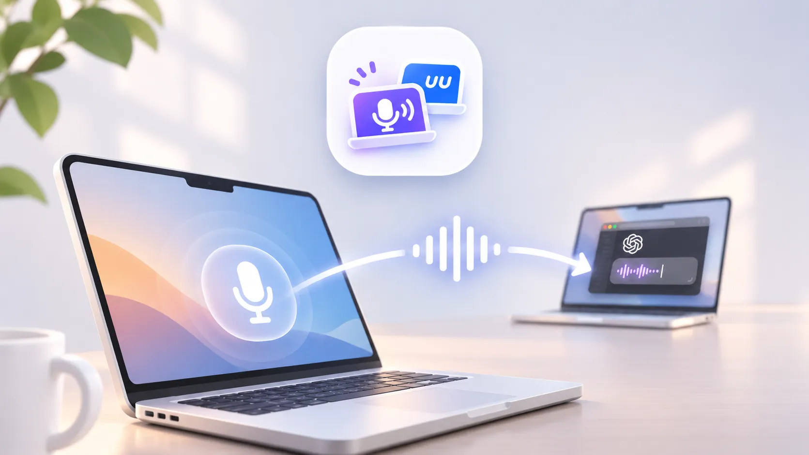
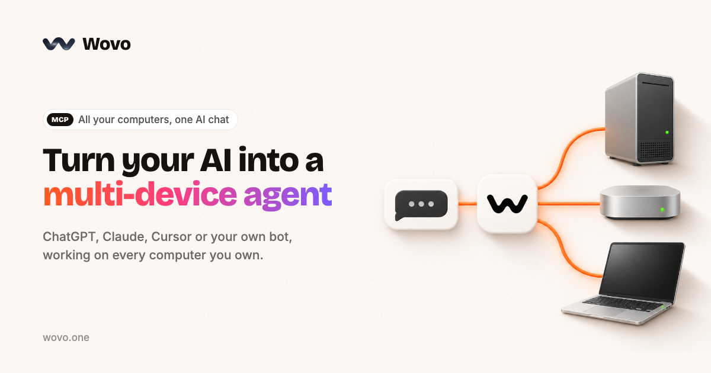

# uu伴侣 (UU Companion)

**让你 UU 远程的设备使用你本地的麦克风。**

Use your local microphone on the Mac you're controlling through UU Remote.

特别适合使用 UU 远程进行 Vibe Coding 的同学：在远程 Mac 上与 AI 交流、写代码时，也能直接用本地麦克风语音输入。

uu伴侣是一款独立的 Mac 麦克风透传工具，**不依赖 UU 远程**。无论你使用 UU 远程、其他远程控制软件，还是只想让两台 Mac 共享麦克风，都可以使用。连接后，远程 Mac 可以像使用本机麦克风一样进行 ChatGPT 语音输入、开会和录音。

免费、MIT 开源，无需账号或订阅。

**[下载最新版本 · GitHub Releases](https://github.com/s1ntoneli/uu-companion/releases)**

> 请从 Releases 下载并查看该版本的 Apple 签名与公证信息。已公证版本无需绕过 Gatekeeper；遇到旧安装包被阻止，请重新下载。

## 主要功能

- 局域网：Bonjour 发现或指定 IP，直接 TCP 连接。
- 公网：两端主动连接 WSS 免费中继，无需固定 IP、端口映射或 VPN。16 位随机配对码代替登录账号。
- 音频在两台 Mac 上经过 CryptoKit ChaCha20-Poly1305 加密，Relay 只看到密文。
- 接收端使用开源的 uu伴侣 Native Mic 驱动（macOS AudioServerPlugIn），不依赖付费 Loopback。
- 当接收端开始录音才自动开启发送端实体麦克风，停止约 3 秒后关麦；心跳超时和异常退出也会关闭麦克风。
- 可选自部署 Relay 服务。官方免费服务不是使用这个应用的必要条件。

## 用户怎么配对

1. **手边的 Mac**：打开 uu伴侣，选择「提供麦克风」，允许麦克风权限。首次使用会生成并复制 16 位配对码。
2. **远程 Mac**：打开 uu伴侣，选择「使用远程麦克风」，按提示安装 Native Mic。应用会检测 macOS 是否已识别设备，并尝试重新加载系统音频服务；**仅在系统仍未识别时才建议重启**。
3. 驱动安装后会自动引导在远程 Mac 输入配对码，粘贴手边 Mac 上复制的 16 位配对码。无需账号，两端均使用 `wss://uu.gokoding.com` 公网中继。
4. 菜单会依次显示 **本机音频已就绪 → 另一台 Mac 已在线 → 音频已就绪 · 等待录音**。这三个状态不同：对方在线不代表本机驱动可以使用。
5. 两台 Mac 都在线后会邀请你**现场试音**，在 uu伴侣内录 12 秒观察电平和有效采样，确认真实声音到达，**不保存录音内容**。通过后再在 ChatGPT、IDE 或其他应用里选择「uu伴侣 Native Mic」；没有录音请求时，手边的 Mac 不会持续开麦。

如果连接失败，菜单会直接显示当前卡住的步骤及「重新连接」「安装驱动」「重启说明」等下一步操作。设置可在以后更改。

**配对码是长期有效的访问凭据**，不要在公开截图中展示；发送端重新生成会撤销旧配对。自建 WSS 中继也支持，双方需使用相同地址。

## 传输架构

发送端 MagicBook（实体麦克风）：
 - uu-sender 在公网模式使用每次启动自动分配的 127.0.0.1 私有端口，避免与 UU Remote 或旧进程占用端口冲突；历史局域网配置保持兼容
 - uu-cloud-bridge 将本机流通过 WSS 加密发送到 Relay

公开开源 Relay：只协调发现和转发加密数据，不保存原始配对码、不解密录音。

接收端 Mini（ChatGPT）：
 - uu-cloud-bridge 在 127.0.0.1 自动分配的私有端口提供本机 TCP 代理，不开放公网入站端口
 - uu-receiver 通过代理接收加密传输后的音频
 - 自有 Native Mic 将声音提供为标准系统输入设备

目前跨公网的 Anywhere 模式是**加密服务器中继**，并非 ICE/P2P 直连。局域网直连是另一个独立模式，不走服务器。

## 本地构建和安装

要求 macOS 14.2+、Apple Silicon。已在 macOS 27 的 Mac mini 和 MagicBook 上完成真实硬件验收。

首先编译：./build.sh

接收端安装虚拟麦克风：只需下载一个 uu伴侣.app。App 内已包含 Developer ID 签名的 Native Mic 驱动；接收端首次选择「使用远程麦克风」时点击「安装」，完成 macOS 管理员授权。应用将尝试重载 Core Audio 并检测设备；只有重载失败时才建议重启接收端。无需单独下载驱动、手动复制系统文件或使用终端。详见 [INSTALL-MAC.md](INSTALL-MAC.md)。

**普通用户无需输入命令行或提供任何旧配对密钥。** App 首次启动会自动生成本机私有的 TCP 认证密钥。开发者如需手动安装、局域网调试，可以使用 install.sh。

开发者也可自行生成 Legacy TCP 的随机密钥文件：
    openssl rand -hex 32 > .pairing-secret

本地发送端：
    ./install.sh sender .pairing-secret

本地接收端：
    ./install.sh receiver .pairing-secret 发送端局域网IP

上述 install.sh 命令中的密钥文件是可选参数；省略时会自动生成或保留已有本机密钥。跨公网 Anywhere 模式下，两台 Mac 的 Legacy TCP 密钥**不必相同**，因为各自只用于本机 Bridge ↔ 本机音频服务的认证。公网两端的加密与发现使用独立的配对码。不要把密钥或配对码提交到 GitHub。

首次打开 App 会在需要时请求麦克风权限；接收端现场试音也会单独申请录音权限。公网 WSS 模式无需局域网授权，只有用户主动切换到局域网模式才可能触发局域网权限提示。登录项按 macOS 正常规则注册。接收端默认输入设备可以设置为 uu伴侣 Native Mic；默认播放输出仍为扬声器。

## 公共服务器与自部署

**Preview 4 是迁移前的历史构建**，App 中可能仍显示 `wss://uu-companion-relay.auv1107.workers.dev`。两者实际接入同一个 Cloudflare Worker；想使用新域名，可在菜单栏选择「发现 / 中继服务器…」并填入 `wss://uu.gokoding.com`。新版 App 会自动将旧官方默认地址迁移到新域名，同时保留自行部署的服务器设置。

免费公开中继（Cloudflare 代理的自有域名）：wss://uu.gokoding.com

健康检查：https://uu.gokoding.com/health

旧版中继地址 `wss://uu-companion-relay.auv1107.workers.dev` 继续保留，已配对的旧版客户端无需立即迁移。更换中继服务器时，配对双方必须使用相同地址。

服务器代码：Relay/worker.mjs（MIT）。使用自己的 Cloudflare 免费账户可运行：
    CLOUDFLARE_ACCOUNT_ID=... CLOUDFLARE_API_TOKEN=... python3 Relay/deploy.py

脚本仅使用 Python 3 标准库和 Cloudflare 官方 API。详细说明见 Relay/README.md。

**完全免费、没有付费功能**不等于托管流量无限：Cloudflare 免费计划有使用配额，免费公共实例属于尽力服务；超过免费额度时流量可能受限。即使公共实例停用，局域网直连和自部署仍可使用。

## 安全与限制

- 公网通道：TLS WebSocket + 设备端 ChaCha20-Poly1305；中继只处理密文。
- 配对码使用 16 个 Base32 字符，约 80 bit 随机熵，经域分离 SHA-256 导出房间标识和两个方向密钥。客户端本地文件权限为 0600。
- 服务器仍可看到配对房间哈希、客户端 IP、连接时间和流量大小；本项目尚未经过独立密码学审计，也尚未实现完整的反重放保护。
- 当前公网模式不能穿透之后的 ICE/P2P；音频由 Relay 转发，因此中继配额会影响使用时长。
- **macOS 27 Core Audio 兼容性**：部分系统可能在启动实体麦克风时阻塞（AVAudioEngine、AudioQueue 均可受影响）。uu伴侣会在等待超过 8 秒后明确报告麦克风启动超时、保持配对网络可用，并在录音停止时撤销迟到启动请求；但无法替代系统修复。必要时请在保存工作后正常重启发送端 Mac。当前 MagicBook 在最后一次测试仍受到此系统问题影响。
- 自有驱动的本机注入接口尚未完成强进程身份校验，请仅在可信 Mac 上使用。
- Preview 4 和 Preview 5 均已完成 Apple 公证；Preview 5 还附加了公证票据，并在下载后通过 Gatekeeper 验证。安装前请阅读对应 Release Notes。Native Mic 驱动在 App 内授权安装后会优先尝试重载系统音频服务，仅在设备仍未识别时提示重启。尚未完成所有 macOS 版本的干净机器首装、长期稳定性验收。

发行签名/公证的严格步骤见 [Signing/README.md](Signing/README.md)。**公证不随版本继承**；每次发布新的二进制包都必须重新提交 Apple 并验证。Preview 5 的 App 已成功附加公证票据，公开 ZIP 重新下载后仍通过 macOS Gatekeeper 校验。

## 验收结果

- 局域网 Native Mic 实际录制 398,400 帧，其中 364,273 个非零采样。
- 公网加密音频桥接后，Mini 独立录音测试捕获 398,400 帧，其中 316,589 个非零采样；发送端停止录音后自动关麦。
- 已在两台 Mac 验证 WSS 上线、鉴权连接、MagicBook 远端录音控制、Mini 虚拟音频输入。
- 本机 Git 提交与原始验收记录：ACCEPTANCE-NATIVE-2026-11-11.md。

### 2026-11-11 最终实测

在 MagicBook CoreAudio 服务恢复后，两次连续独立实测均成功：Mini 第一轮录得 398400 帧、76528 个非零采样，第二轮 398400 帧、324806 个非零采样；第二轮远端麦克风在 0.71 秒内启动，两次结束后都自动关麦。容错版在 macOS 音频服务再度卡住时仍会报告超时、响应关麦请求。原始时间、技术限制见 [ACCEPTANCE-CLOUD-2026-11-11.md](ACCEPTANCE-CLOUD-2026-11-11.md)。

在修复首次 TCC 麦克风权限申请、云桥接本机服务重试和发送端音频图预初始化后，又完成连续三轮公网音频验收：每轮 398400 帧，分别 259716、327266、327692 个非零采样；开麦耗时 0.62 秒、0.60 秒、0.82 秒。第三轮是在 MagicBook uu伴侣完全退出并重新启动后的首次录音。三轮均按需开麦、按需关麦。仍需在干净 Mac 上完成首次安装与正常开机启动等测试。

下载时请从 [GitHub Releases](https://github.com/s1ntoneli/uu-companion/releases) 选择最新适用版本，并核对该版本的签名/公证信息。请依照 [安装说明](INSTALL-MAC.md) 在 App 内点击安装 Native Mic 驱动，不要绕过 Gatekeeper 或 SIP。

## License

MIT。原始第三方 MIT 授权声明见 THIRD_PARTY_NOTICES.md、LICENSE-MicBridge-MIT.txt 和 NativeMic/LICENSE-Hush-MIT.txt。

## 鸣谢 · Powered by Wovo

uu伴侣 的开发与多端联调借助了 **[Wovo](https://wovo.one/)**：AI 直接连接 MagicBook 和 Mac mini，在真实设备上完成代码修改、远程构建、日志排障，以及跨 Mac 麦克风链路测试。

**让 AI 不止能写代码，还能使用你的电脑。** Wovo 能跨设备操作真实桌面与开发环境，帮你从实现一路走到测试与验收。开发 Mac App、远程协作或自动化工作流时，可以试试 **[wovo.one](https://wovo.one/)**。

